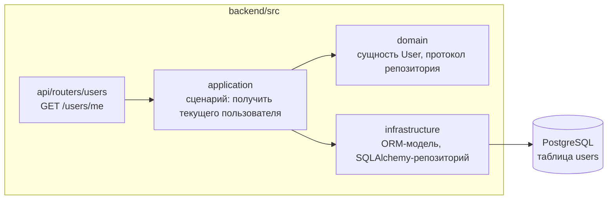
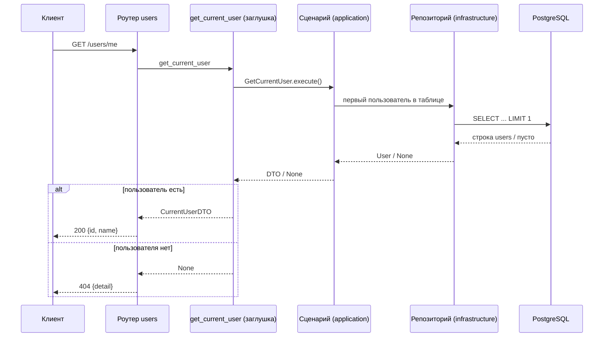

# Design

[[_TOC_]]

## Введение

В системе нет сущности пользователя: схема БД пустая, слои `domain` / `application` — пакеты-заглушки. Это изменение вводит пользователя как опорную сущность: таблица `users` в PostgreSQL, сквозная цепочка слоёв DDD (доменная сущность → репозиторий → сценарий → REST-роутер) и эндпоинт `GET /users/me`. Схема аутентификации не проектируется: определение «текущего пользователя» изолируется в подменяемой FastAPI-зависимости.

В рамках этого изменения мы **делаем**:

- таблицу `users` и миграцию Alembic;
- доменную сущность пользователя, репозиторий и сценарий получения текущего пользователя;
- эндпоинт `GET /users/me` с временной заглушкой определения текущего пользователя.

Мы **не делаем** (скоуп других изменений): аутентификацию и авторизацию (логин, токены, сессии, регистрацию); CRUD пользователей; привязку Spot/Dive к пользователю; изменения фронтенда.

## Контракты

`GET /users/me` — информация о текущем пользователе.

Успех, `200 OK`:

```jsonc
{
  "id": "3fa85f64-5717-4562-b3fc-2c963f66afa6",
  "name": "budaev"
}
```

Текущий пользователь не найден в БД, `404 Not Found`:

```jsonc
{
  "detail": "Текущий пользователь не найден"
}
```

Метки времени (`created_at`, `updated_at`) в ответ не включаем: у клиента нет сценария их потребления. Если появится — расширим ответ без ломающих изменений.

## Хранение и данные

### PostgreSQL (данные)

Новая таблица `users`, создаётся миграцией Alembic поверх пустой initial-миграции:

| Колонка | Тип | Ограничения | Назначение |
| --- | --- | --- | --- |
| `id` | `UUID` | PK | идентификатор, генерируется приложением (`uuid4`) |
| `name` | `TEXT` | NOT NULL | отображаемое имя |
| `created_at` | `TIMESTAMPTZ` | NOT NULL, default `now()` | время создания записи |
| `updated_at` | `TIMESTAMPTZ` | NOT NULL, default `now()` | время обновления записи |

Учётные данные для входа (email, хеш пароля и т.п.) сознательно не моделируются: схема аутентификации отложена, а угаданные сейчас колонки с высокой вероятностью придётся переделывать. Появятся позже отдельной миграцией вместе с auth-изменением.

Миграция данные не сидит. Пользователь по умолчанию для локальной разработки создаётся вручную (INSERT); когда появится auth/регистрация, ручное создание уйдёт.

### Minio (файлы)

Не затрагивается.

## Архитектура

Пользователь проходит сквозь все слои по принятой в проекте DDD-структуре:



- **domain** — сущность `User` (dataclass) и протокол репозитория; не знает ни о FastAPI, ни о SQLAlchemy.
- **application** — сценарий «получить текущего пользователя»: оркестрирует репозиторий, отображает сущность в DTO ответа.
- **infrastructure** — ORM-модель `users` и реализация репозитория на синхронном SQLAlchemy 2.0 (решение из фундамента сохраняется).
- **api** — роутер пользователей, pydantic-схема ответа, зависимость `get_current_user`; регистрируется в `create_app` рядом с health.

## Процесс

Запрос `GET /users/me` в текущем (временном) контуре:



Когда появится аутентификация, меняется только тело `get_current_user` (разбор токена/сессии вместо «первого пользователя») — контракт эндпоинта, сценарий и репозиторий остаются прежними.

## Конфигурация

Новых переменных окружения изменение не вводит: подключение к БД уже настроено через `DATABASE_URL`.

## Риски / Ограничения

- **Заглушка вместо аутентификации** — `GET /users/me` фактически публичен и отдаёт единственного пользователя. Принимаем осознанно и временно: приложение пока локальное, до деплоя auth-решение владельца обязательно (открытый вопрос AGENTS.md). Смягчение: вся «временность» локализована в одной зависимости.
- **Схема `users` без auth-полей** — при появлении входа потребуется новая миграция (email/пароль/внешний идентификатор). Принимаем: добавление колонок дешевле, чем переделка угаданной заранее модели.
- **404 при пустой таблице** — до первого созданного пользователя эндпоинт отвечает ошибкой. Принимаем как честное поведение: пользователь по умолчанию создаётся вручную для разработки.

## Решения

**UUID как первичный ключ.** Идентификатор пользователя отдаётся наружу в API, поэтому берём `uuid4` вместо автоинкремента: не раскрывает количество пользователей, удобен при будущем объединении источников. Цена — чуть более дорогие индексы — для персонального приложения несущественна.

**Минимальный набор колонок, без полей входа.** Моделируем только то, что нужно контракту `GET /users/me` сейчас: `id`, `name`, метки времени. Email/пароль не добавляем: без выбранной схемы аутентификации это угадывание, а переделка модели дороже, чем добавление колонок миграцией позже.

**Текущий пользователь — подменяемая зависимость.** Определение «кто сейчас» вынесено в FastAPI-зависимость `get_current_user`, а не размазано по роутеру. Заглушка возвращает первого пользователя таблицы — простейшее поведение, позволяющее работать всей цепочке и тестам. Альтернатива «возвращать 401, пока нет auth» отклонена: эндпоинт нельзя было бы проверить end-to-end, а заглушку всё равно пришлось бы писать для тестов. Альтернатива «зафиксировать UUID пользователя по умолчанию в настройках» отклонена: лишняя конфигурация ради временного механизма.

**Сидирование — вне миграции.** Миграции описывают схему, а не данные: сид в миграции смешивает эти ответственности и усложняет откат. Пользователь по умолчанию создаётся вручную в локальной БД; автоматизация появится вместе с регистрацией.

**Слои по DDD, как в фундаменте.** Сущность и протокол репозитория — в `domain`, реализация — в `infrastructure`, сценарий — в `application`, HTTP — в `api`. Плоский вариант «роутер + ORM» быстрее на один файл, но ломает принятую в проекте структуру и создаёт первый прецедент обхода слоёв.

## Дальнейшие шаги

- **Аутентификация и авторизация**: выбор схемы (сессии/JWT/OAuth), регистрация, замена заглушки `get_current_user`; добавление auth-полей в `users` отдельной миграцией.
- **Привязка Spot/Dive к пользователю**: внешний ключ `user_id` и фильтрация по владельцу — после появления auth.
- **CRUD пользователей и профиль**: редактирование имени, возможно аватар — по запросу владельца.
