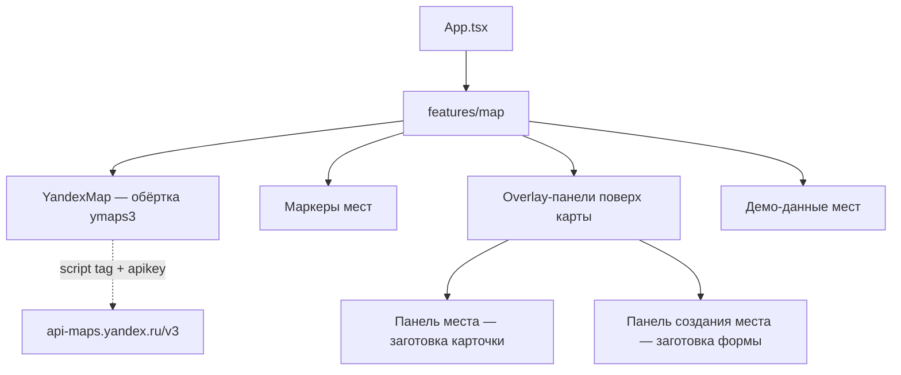
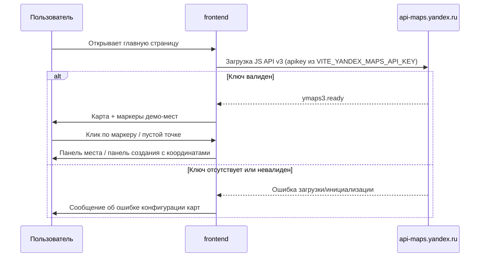

# Design

[[_TOC_]]

## Введение

Главный экран фронтенда сейчас — заглушка с health-check (`frontend/src/App.tsx`). Это изменение превращает его в полноэкранную интерактивную Яндекс.Карту с маркерами мест и панелями поверх неё. Данные мест пока демонстрационные (захардкоженный список), потому что API мест появится только в куске «Карта + Spot» вместе с бэкендом.

В рамках этого изменения мы **делаем**:

- Подключение Яндекс.Карт JS API v3 к React-приложению с типизацией.
- Полноэкранную карту с панорамированием, зумом и стандартными контролами.
- Маркеры мест по координатам, клик по маркеру открывает панель-заготовку карточки места.
- Клик по пустой точке карты — получение координат и открытие панели-заготовки создания места.
- Обработку отсутствующего/невалидного API-ключа (сообщение вместо белого экрана).

Мы **не делаем** (скоуп других изменений):

- Интеграцию с API мест (будет в куске «Карта + Spot» вместе с моделью Spot на бэкенде).
- Полноценные формы места и карточку места — здесь только заготовки панелей и механика их открытия/закрытия с карты.
- Сайдбар со списком мест, кластеризацию, поиск, геокодирование, кастомные иконки маркеров.

## Хранение и данные

Новых хранилищ не появляется. На время этого изменения список мест — константа на фронтенде (массив `{ name, coordinates: [lng, lat], description? }`), структурно совместимая с будущей моделью Spot. Реальное хранение мест появится позже, в этапе 2 «Карта + Spot» (PostgreSQL через backend API).

## Архитектура

Ключевые точки:

- **Подключение API**: скрипт `https://api-maps.yandex.ru/v3/?apikey=<ключ>&lang=ru_RU` загружается один раз при монтировании карты; далее используется глобальный `ymaps3`. Типизация — пакет `@yandex/ymaps3-types` (dev-зависимость).
- **React-интеграция**: официальный модуль `@yandex/ymaps3-reactify` загружается через `ymaps3.import()`; вызов `reactify.bindTo(React, ReactDOM)` возвращает React-компоненты (`YMap`, `YMapDefaultSchemeLayer`, `YMapDefaultFeaturesLayer`, `YMapMarker`, `YMapListener` и т.д.), привязанные к установленному React 19. Это официально поддерживаемый Яндексом способ, в отличие от сторонних обёрток.
- **Панели — обычный React-overlay**: карточка места и форма создания рендерятся как абсолютно позиционированные React-компоненты поверх контейнера карты, а не как балуны API. Это даёт полный контроль над вёрсткой и не привязывает UI к ограничениям балунов. Маркеры — `YMapMarker` с простым кастомным содержимым.
- **Клики по карте**: `YMapListener` с обработчиком, который получает координаты точки клика; клик по маркеру останавливается на маркере и не провоцирует создание места.
- **Состояние экрана**: одно состояние «какая панель открыта» (закрыто / место N / создание в точке X) в компоненте фичи; карта не перемонтируется при открытии панелей.

## Процесс

Получение API-ключа (разовый шаг вне кода): регистрация в кабинете разработчика Яндекса, создание ключа для «JavaScript API и HTTP Геокодер», привязка доменов (localhost для dev, боевой домен для prod).

## Конфигурация

| Имя | Назначение | Пример |
|---|---|---|
| `VITE_YANDEX_MAPS_API_KEY` | API-ключ Яндекс.Карт JS API v3, подставляется в URL загрузки скрипта | `a1b2c3d4-...` |

Значение берётся из окружения Vite: локально — `frontend/.env` (покрыт `.gitignore` корня репозитория, в git не попадает; единообразно с подходом бэкенда), в проде — переменная окружения при сборке образа фронтенда. Без ключа приложение показывает сообщение об ошибке конфигурации вместо карты.

## Риски / Ограничения

- [Бесплатный тариф API имеет суточные лимиты запросов] -> принимаем: для персонального проекта с одним пользователем лимиты бесплатного тарифа недостижимы; при росте — вопрос решается платным тарифом без смены кода.
- [Карта загружается с CDN Яндекса — runtime-зависимость от внешнего сервиса] -> принимаем: это природа картографических API; fallback — сообщение об ошибке, а не падение приложения.
- [React 19 — относительно свежая версия, совместимость обёрток под вопросом] -> смягчаем выбором официального механизма reactify: он привязывается к переданному экземпляру React и не содержит собственной копии, поэтому не конфликтует с версией React приложения.
- [Ключ попадёт в клиентский код и будет виден публично] -> принимаем: это штатная модель картографических JS API; защита — привязка ключа к доменам в кабинете разработчика.

## Решения

**Яндекс.Карты JS API v3, а не старый API 2.1 с `react-yandex-maps`.** Популярная обёртка `react-yandex-maps` (и её форки) построена на API 2.1, давно не поддерживается оригинальным автором (последние релизы — сторонние патчи под React 19) и тянет устаревший API, который Яндекс заменяет третьей версией. JS API v3 — актуальная, развиваемая Яндексом версия с нормальной TypeScript-типизацией (`@yandex/ymaps3-types`). Цена — чуть более многословная инициализация (загрузка скрипта + reactify), которая однократно инкапсулируется в одном компоненте.

**Официальный `ymaps3-reactify`, а не сторонние React-обёртки над v3.** Существующие обёртки (`react-ymaps3`, `ymap3-components` и др.) — любительские, с малым числом пользователей. Официальный модуль `@yandex/ymaps3-reactify` документирован Яндексом как штатный способ интеграции с React и обновляется вместе с API.

**Панели поверх карты — обычные React-компоненты, а не балуны API.** Балуны (hint/popup) картографических API ограничены в вёрстке и плохо дружат с React-деревом. По утверждённому user flow карточка и формы — «панели поверх карты», то есть самостоятельный UI. Абсолютно позиционированный overlay в том же React-дереве даёт полный контроль, нормальный state management и не требует порталов внутрь DOM карт.

**Демо-данные мест вместо ожидания бэкенда.** API мест ещё не существует; блокировать карту до его появления нет смысла — механика маркеров и панелей полностью отрабатывается на константном списке, а структура данных закладывается совместимой с будущей моделью Spot, чтобы переход на API был заменой источника данных, а не переделкой компонентов.

## Дальнейшие шаги

- Этап 2 «Карта + Spot»: модель Spot на бэкенде, API мест, замена демо-данных на реальные, полноценные форма места и карточка места в уже существующих панелях, сайдбар со списком мест.
- При росте числа мест — кластеризация маркеров (`@yandex/ymaps3-clusterer`).
- Открытый вопрос (владельцу, до деплоя): получить API-ключ в кабинете разработчика Яндекса и привязать домены; без ключа карта не заработает ни локально, ни в проде.
