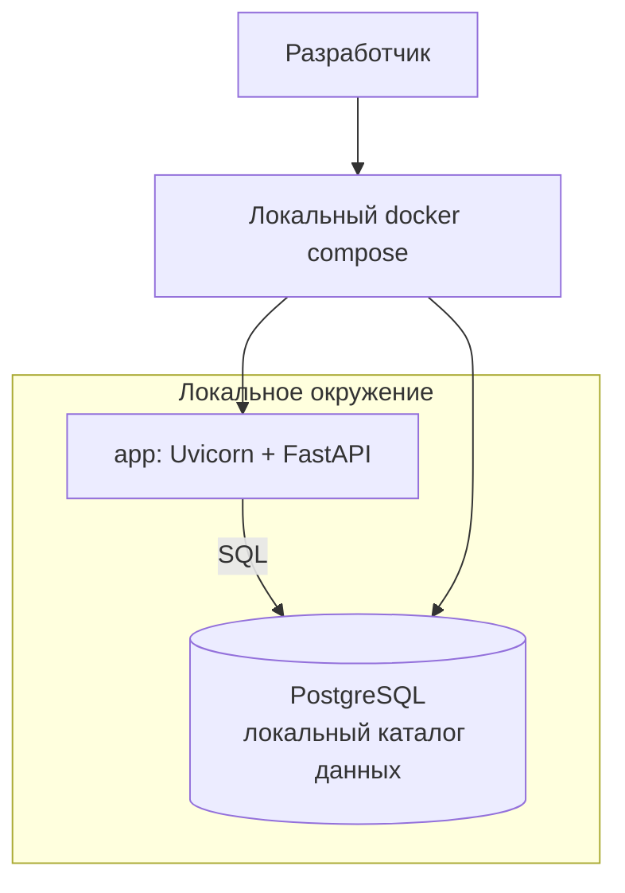
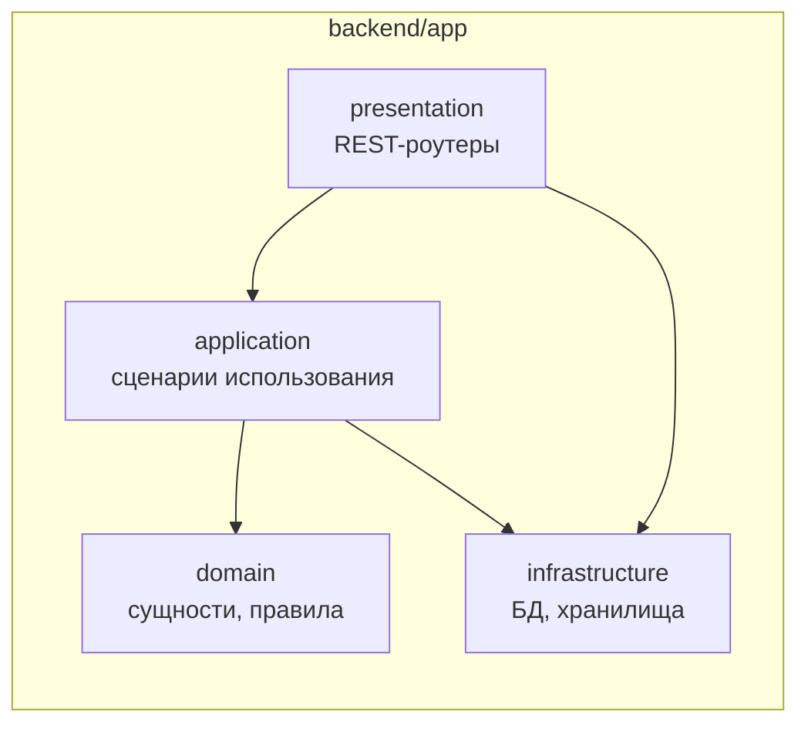
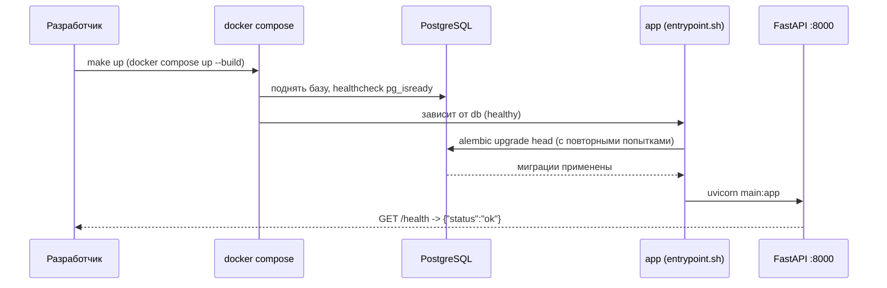

# Design

[[_TOC_]]

## Введение

Проект divemap — персональный дайвлог с интерактивной картой. Репозиторий greenfield: только документация, кода и инфраструктуры нет. Это изменение реализует **этап 1 — фундамент** в минимальном объёме: локальное окружение разработки (приложение + PostgreSQL) и каркас бэкенда со слоистой структурой, готовый к этапам 2–4.

В рамках этого изменения мы **делаем**:

- локальный запуск окружения одной командой, данные переживают перезапуск контейнеров;
- каркас бэкенда со слоями `presentation / application / domain / infrastructure`;
- служебный health-check эндпоинт сервиса.

Мы **не делаем** (обозначено как скоуп других изменений): деплой на VPS и reverse proxy (Caddy), домен, TLS и публичную ссылку; объектное хранилище Minio (добавится в этапе «Фото»); бизнес-функциональность (Spot/Dive, карта, фото); авторизацию; CI/CD, мониторинг и алертинг.

## API

Единственный открытый в этом изменении HTTP-эндпоинт — проверка состояния сервиса.

`GET /health` отвечает `200 OK`:

```jsonc
{
  "status": "ok"
}
```

## Хранение данных

### PostgreSQL (данные)

Критерии MVP требуют реального хранения, переживающего рестарт, поэтому данные лежат в PostgreSQL в Docker Compose, а не в памяти процесса или localStorage. Конкретная мажорная версия не фиксируется — образ берётся актуальный (`postgres:18`).

Данные хранятся в **локальном bind-mount каталоге хоста** `backend/.data/pgdata`, а не в именованном томе Docker: каталог нагляден и легко чистится локально. В `.gitignore` каталог `.data/` исключён.

Схема БД управляется **Alembic**: инициализация миграций, `env.py` читает конфигурацию приложения (DSN из `AppSettings`), стартовая пустая миграция. Фактическая схема появится вместе с сущностями на этапах 2–4.

### Minio (файлы)

Объектное хранилище Minio для фото появится позже, в этапе «Фото» (этап 4), когда понадобится загрузка файлов. В этом изменении Minio не подключается: без потребителя до этапа 4 он добавил бы лишние сервисы и секреты. Подробнее о причинах — в разделе «Решения».

## Архитектура

Локальное окружение собирается одним `docker compose`, приложение подключается к базе через SQL:



Код бэкенда — слоистый DDD, слои наполняются по мере этапов (domain появится с сущностями Spot/Dive):



- **presentation** (`src/api`) — FastAPI-приложение и роутеры; сегодня содержит только health.
- **application** (`src/application`) — сценарии использования; пока пакет-заглушка.
- **domain** (`src/domain`) — бизнес-сущности и правила; пока пакет-заглушка.
- **infrastructure** (`src/infrastructure`) — хранение данных: SQLAlchemy engine/session, `Base`, проверка соединения.

## Процесс запуска

Одна команда поднимает базу, применяет миграции и стартует сервер одной последовательностью; гонка закрыта зависимостью от здоровья базы и повторными попытками подключения:



## Конфигурация

Конфигурация — только через переменные окружения: `pydantic-settings` читает `.env`. `.env.example` документирует переменные и лежит в репозитории, секреты — нет.

| Переменная | Назначение | Пример |
| --- | --- | --- |
| `APP_ENV` | окружение | `local` |
| `APP_DEBUG` | режим отладки (читаемые логи) | `true` |
| `LOG_LEVEL` | уровень логирования | `DEBUG` |
| `DATABASE_URL` | DSN подключения к PostgreSQL (обязательная) | `postgresql+psycopg://divemap:divemap@db:5432/divemap` |
| `OTEL_SDK_DISABLED` | отключить телеметрию | `true` |
| `OTEL_EXPORTER_OTLP_ENDPOINT` | OTLP-коллектор | `http://localhost:4317` |

`DATABASE_URL` — обязательная: приложение завершается с понятной ошибкой, если переменная не заполнена. Учётные данные `POSTGRES_USER/PASSWORD/DB` задаются сервису `db` в compose и должны совпадать с указанными в `DATABASE_URL`.

## Риски / Ограничения

- **Health-check без проверки БД** — контейнер `app` может быть «жив», пока БД недоступна. Осознанно для данного этапа; проверка подключения к PostgreSQL наводится позже, отдельным техкачеством.
- **Миграции при старте контейнера** — допустимо, пока инстанс приложения один. При появлении реплик миграции выносятся в отдельный job.
- **Нет прода и публичной ссылки после этого изменения** — осознанно: критерий MVP «публичная ссылка» закрывается отдельным изменением про деплой.
- **Шаблон привносит незаявленные фичи** (телеметрия, devcontainer, CI) — осознанно сохраняются как есть; адаптация/удаление не входят в это изменение.

## Решения

**Каркас из шаблона `python-template`.** Backend генерируется из собственного шаблона через Copier, а не пишется с нуля. Шаблон уже даёт FastAPI-приложение с health-роутером, конфигурацию из `.env`, Dockerfile, compose, Makefile, логирование, тесты и линтеры — так быстрее и без потери отработанных решений. Чужой стартер не берём: собственный шаблон — наша точка стандартизации. Чего в шаблоне нет, добавляем здесь: PostgreSQL (SQLAlchemy 2.0 + psycopg), Alembic, DDD-слои и сервис `db`.

**Зависимости через `uv`.** Быстро и с lock-файлом из коробки. `requirements.txt` не даёт lock и отклонён; `Poetry` тяжелее и медленнее при похожих возможностях.

**Слоистая DDD-структура.** Слои `presentation / application / domain / infrastructure` создаём сейчас как каркас и наполняем по этапам. Так бизнес-логика не течёт в роутеры, а структура соответствует контексту проекта. Плоский вариант «роутеры + модели» противоречил бы этому и дороже переносится позже.

**Синхронный SQLAlchemy 2.0.** FastAPI выполняет синхронные вызовы в threadpool — для CRUD одного пользователя этого достаточно, а код проще. Async SQLAlchemy + asyncpg добавил бы двойную сложность (async engine, async-миграции) без выгоды для MVP.

**PostgreSQL с локальным bind-mount.** Нужно реальное хранение, переживающее рестарт, и окружение, совпадающее с продом. SQLite не подходит — расходится с продом. Данные держим в каталоге `backend/.data/pgdata`, а не в именованном томе Docker: так их нагляднее отсматривать и чистить.

**Миграции — при старте контейнера.** `docker compose up --build` поднимает базу, накатывает миграции и запускает сервер одной последовательностью. Гонку закрывают `depends_on: service_healthy` и повторные попытки подключения. Ручной запуск миграций отклонён — легко забыть, лишний шаг в запуске.

**Конфигурация — только через переменные окружения.** `pydantic-settings` читает `.env`; `.env.example` документирует переменные, секреты в репозиторий не попадают. Хардкод и отдельные конфиги для сред отклонены — рассинхронизация и риск закоммитить секреты.

**Minio — позже, в этапе «Фото».** До загрузки фото хранилище не нужно, а без него фундамент проще: меньше сервисов и секретов. Включать Minio сразу не стали — до этапа 4 у него нет потребителя.

**Деплой — позже.** Полный bootstrap (VPS, Caddy, домен, публичная ссылка) выносим в отдельное изменение: сначала нужен рабочий контур разработки для этапов 2–4. Делать всё сразу отклонено решением владельца — избыточно для старта, домен и сервер ещё не готовы.

## Дальнейшие шаги

- Добавление Minio и деплой — расширение compose-контура, обратной миграции не требуют: зелёное поле, деплоя и данных нет.
- **Деплой и публичная ссылка**: когда и как (VPS, Caddy, домен, TLS) — отдельное изменение после этапа 2.
- **Авторизация публичной записи**: открытый вопрос `AGENTS.md` — любой по ссылке сможет редактировать данные; решение владельца требуется до деплоя.
- **ADR-процесс**: каталога `adr/` нет; если процесс заведётся, решения из этого документа (DDD-слои, uv, синхронный SQLAlchemy) следует оформить стартовыми ADR.
