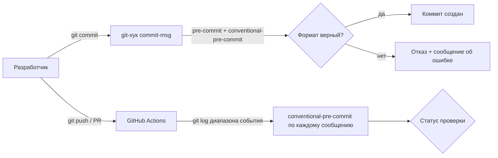
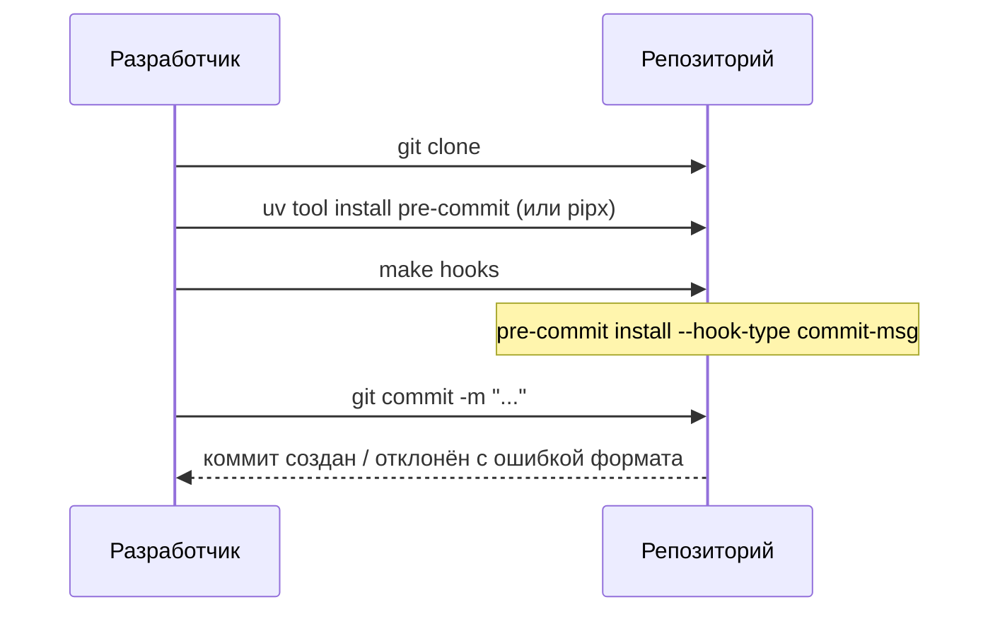

# Design

[[_TOC_]]

## Введение

В репозитории нет механизмов проверки коммит-сообщений: ни локальных хуков, ни workflow в корневом `.github/` (его не существует). Существующий `backend/.github/workflows/ci.yml` GitHub Actions не подхватывает — workflow-файлы читаются только из корня репозитория; вынесение backend CI в корень — отдельное изменение, здесь оно только учитывается при выборе расположения нового workflow. Существующая история коммитов уже соответствует conventional commits, поэтому миграция истории не нужна.

В рамках этого изменения мы **делаем**:

- конфигурацию pre-commit в корне репозитория с хуком `commit-msg` на базе conventional-pre-commit;
- make-цель в корневом `Makefile` для установки хуков;
- workflow GitHub Actions в корне `.github/workflows/`, проверяющий коммит-сообщения в push и pull request тем же валидатором;
- инструкцию по установке хуков в `CONTRIBUTING.md`.

Мы **не делаем** (скоуп других изменений):

- перенос/починку `backend/.github/workflows/ci.yml` (обнаруженная проблема, отдельный change);
- проверки pre-commit на других стадиях (lint, format);
- генерацию changelog и автоверсионирование;
- переписывание истории коммитов.

## Хранение и данные

Новых данных и хранилищ не появляется. Изменяются только файлы конфигурации в репозитории:

- `.pre-commit-config.yaml` (новый, корень) — конфигурация хука `commit-msg`;
- `.github/workflows/commits.yml` (новый, корень) — CI-проверка;
- `Makefile` (корень) — новая цель `hooks`;
- `CONTRIBUTING.md` — раздел «Соглашения по коммитам» дополняется инструкцией.

## Архитектура

Единый валидатор — пакет `conventional-pre-commit`: локально он вызывается pre-commit'ом как git-хук, в CI — напрямую (`conventional-pre-commit` принимает сообщение через stdin/аргумент) для каждого коммита диапазона события. Так локальная и CI-проверки не расходятся в правилах.

## Процесс

Локальная настройка на новой машине:

Проверка в CI:

1. Workflow срабатывает на `push` и `pull_request`.
2. Checkout с `fetch-depth: 0`, чтобы был доступен диапазон коммитов.
3. Определяется диапазон: для push — `before..after` из события, для PR — `base..head`.
4. Каждое сообщение из `git log --format=%B` диапазона передаётся в `conventional-pre-commit`; любое нарушение — exit code != 0, job падает, в логе видно проблемное сообщение.

## Конфигурация

Переменные окружения не вводятся. Параметры хранятся в `.pre-commit-config.yaml`:

| Параметр | Назначение | Пример |
|---|---|---|
| `repos[].repo` | репозиторий хука | `https://github.com/compilerla/conventional-pre-commit` |
| `repos[].rev` | пин версии хука | `v4.3.0` |
| `hooks[].stages` | стадия срабатывания | `[commit-msg]` |
| `hooks[].args` | разрешённые типы (при сужении списка) | по умолчанию полный список conventional commits |

## Риски / Ограничения

- [Разработчик забудет установить хуки после клонирования] -> принимаем: CI-проверка — страховка; инструкция добавлена в `CONTRIBUTING.md`, установка — одна команда.
- [Хук обходится флагом `--no-verify`] -> принимаем осознанно: проект одиночный, флаг — явное действие владельца; CI всё равно отловит нарушение в push/PR.
- [Зависимость от внешнего репозитория хука] -> смягчаем пином версии (`rev` с тегом); при недоступности хука ломается только локальная проверка, CI можно перевести на `pip install conventional-pre-commit` из PyPI.
- [Merge-коммиты и коммиты ботов (dependabot и т.п.) могут не соответствовать формату] -> смягчаем: в CI-цикле merge-коммиты (`Merge ...`) исключаются из проверки (`git log --no-merges`); ботов при появлении настроим отдельно.
- [Существующий `backend/.github/workflows/ci.yml` не исполняется GitHub Actions] -> фиксируем как известную проблему вне скоупа; новый workflow кладём в корень, чтобы не повторить ошибку.

## Решения

**pre-commit + conventional-pre-commit вместо husky + commitlint.** Стек проекта — Python (uv), Node-инфраструктуры в корне нет, а `frontend/` появится позже. pre-commit — Python-нативный фреймворк, ставится через `uv tool install`, конфигурация — один YAML-файл в корне. commitlint потянул бы package.json, node_modules и менеджер хуков ради одной проверки — непропорционально задаче. Свой shell-хук отвергнут: своя регулярка неизбежно расходится со спецификацией conventional commits в деталях (скоупы, `BREAKING CHANGE`, восклицательный знак), а готовый хук поддерживается сообществом.

**Тот же валидатор в CI вместо отдельного action.** Готовые actions (например, проверяющие заголовок PR) проверяют не то, что проверяет локальный хук, — правила разъедутся. Поэтому CI ставит `conventional-pre-commit` из PyPI и прогоняет через него сообщения диапазона события: правила едины, версию можно пиновать одинаково.

**Workflow в корневом `.github/workflows/`.** GitHub Actions игнорирует workflow-файлы вне этой директории; `backend/.github/workflows/ci.yml` — мёртвая конфигурация (отдельная проблема, вне скоупа). Новый workflow размещаем корректно сразу.

**Установка хуков через make-цель.** Корневой `Makefile` существует, но пока пуст — цель `hooks` (обёртка над `pre-commit install --hook-type commit-msg`) станет его первой командой верхнего уровня; она идемпотентна и не требует запоминания флагов.

## Дальнейшие шаги

- Перенести/восстановить backend CI в корневой `.github/workflows/` (обнаружено в ходе проектирования, отдельное изменение).
- С появлением `frontend/` рассмотреть расширение pre-commit на стадию `pre-commit` (ruff, eslint) — общий конфиг уже будет в корне.
- Генерация changelog и автоверсионирование по типам коммитов — после того, как история стабильно соответствует формату.
