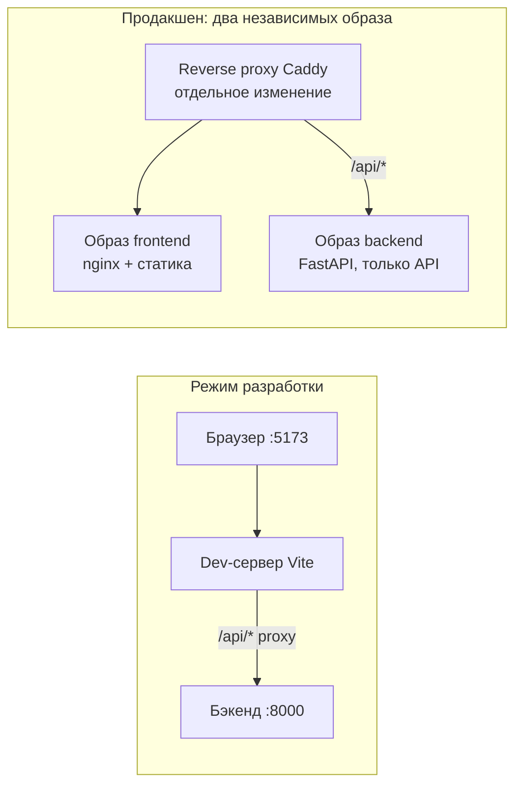
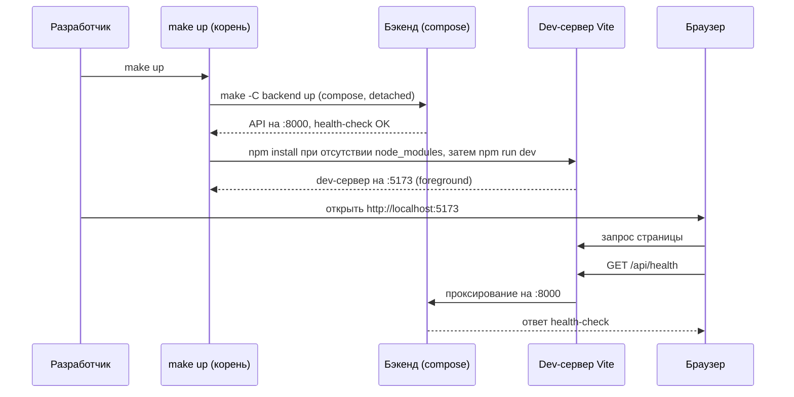
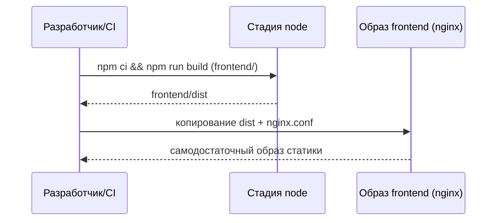

# Design

## Введение

Фронтенд divemap начинается с нуля: в репозитории есть только `backend/` (FastAPI + PostgreSQL). Это изменение создаёт `frontend/` — каркас одностраничного приложения на React + TypeScript с toolchain на Vite, слоем доступа к API и собственным Docker-образом. Ключевое ограничение: владелец — бэкенд-разработчик, поэтому каркас обязан быть минимальным и читаемым, без библиотек «на вырост».

Фронтенд и бэкенд разделяются на уровне сборки и деплоя: два независимых образа, бэкенд остаётся чистым API-сервисом и статику не отдаёт. Склеивание их в продакшене (reverse proxy, маршрутизация путей) — сознательно вне скоупа этого изменения.

В рамках этого изменения мы **делаем**:

- Каркас `frontend/`: Vite + React + TypeScript (strict), oxlint, скрипты `dev`/`build`/`lint`
- Слой доступа к API: единый fetch-клиент, типы ответов, TanStack Query как кэш серверного состояния
- Dev-сервер с проксированием `/api` на локальный бэкенд (порт 8000)
- Корневой `Makefile` как единая точка входа: `make up` поднимает всё окружение, отдельные цели — каждую часть
- `frontend/Dockerfile`: отдельный самодостаточный образ фронтенда (nginx + собранная статика)
- CI-проверки фронтенда: lint, `tsc --noEmit`, production-сборка
- Заглушку главного экрана, которая дёргает health-check бэкенда — живая демонстрация связки до этапа «Карта + Spot»

Мы **не делаем** (скоуп других изменений):

- Маршрутизацию запросов в продакшене (Caddy, пути `/api` vs статика), деплой на VPS, домен — отдельное изменение про инфраструктуру
- Изменения бэкенда: его код, `Dockerfile` и `compose.yml` не трогаем
- Карту и любые функциональные экраны (создание места, карточка, журнал) — этапы 2–4
- Маршрутизацию внутри приложения — экран один, панели поверх карты
- Клиентский state-менеджер (Redux/Zustand) — см. «Решения»

## Архитектура

Структура каталога `frontend/`:

```text
frontend/
├── Dockerfile            # отдельный образ: сборка (node) -> runtime (nginx + dist)
├── nginx.conf            # раздача статики, fallback на index.html
├── index.html
├── package.json
├── tsconfig.json
├── vite.config.ts
├── eslint.config.js
└── src/
    ├── main.tsx            # точка входа, монтирование React, провайдеры
    ├── App.tsx             # корневой компонент, композиция экрана
    ├── api/                # слой доступа к бэкенду
    │   ├── client.ts       # единый fetch-клиент (base URL, обработка ошибок)
    │   └── health.ts       # пример endpoint-функции + тип ответа
    ├── components/         # переиспользуемые UI-компоненты
    ├── features/           # функциональные модули (наполнение — этапы 2–4)
    └── styles/             # глобальные стили
```

Схема взаимодействия:



Принцип: фронтенд ничего не знает об адресе бэкенда — все запросы идут на относительный `/api`. В dev-режиме проксирование делает Vite, в продакшене склейку выполнит reverse proxy (отдельное изменение про инфраструктуру). Бэкенд при этом остаётся чистым API-сервисом: его код, `Dockerfile` и `compose.yml` это изменение не трогает.

Образ фронтенда — двухстадийный: стадия сборки на `node` (`npm ci && npm run build`), итоговый образ на `nginx` содержит только веб-сервер и `dist/`. Инструменты сборки в финальный образ не попадают.

## Процесс

Запуск локального dev-окружения — одна команда из корня репозитория:



Бэкенд поднимается в фоне (compose detached), dev-сервер Vite остаётся на переднем плане. Остановка: `make down` гасит обе части (dev-сервер — через pkill по пути проекта, бэкенд — compose down); фронтенд, запущенный вручную на переднем плане, по-прежнему останавливается Ctrl-C. Раздельный запуск и остановка обеспечивают цели `up-backend` / `up-frontend` / `down-backend` / `down-frontend`.

Сборка образа фронтенда:



## Конфигурация

| Параметр | Назначение | Пример |
|---|---|---|
| `VITE_API_BASE` | Базовый путь API для fetch-клиента | `/api` (по умолчанию, менять не требуется) |
| proxy target в `vite.config.ts` | Адрес локального бэкенда в dev-режиме | `http://localhost:8000` |

Порт dev-сервера Vite — стандартный 5173, конфигурации не требует. Порт nginx внутри образа фронтенда — стандартный 80, публикация порта на хосте будет зафиксирована в изменении про инфраструктуру.

## Риски / Ограничения

- [Отсутствие фронтенд-экспертизы у владельца] -> каркас сознательно минимален: один пакетный менеджер (npm, уже установлен в окружении), без роутера, без state-менеджера, без UI-кита; структура каталогов фиксируется в design и README. Принимаем ценой того, что при росте проекта часть решений придётся пересмотреть — это дешевле, чем поддерживать с первого дня абстракции, которыми никто не пользуется.
- [Два образа без reverse proxy пока не образуют работающий продакшен] -> принимаем осознанно: это изменение готовит артефакты, склейка (Caddy, маршрутизация `/api`) описывается отдельным изменением про инфраструктуру до деплоя. Локальная разработка при этом полноценна уже сейчас.
- [Рассинхрон типов API между бэкендом и фронтендом при ручном описании] -> на каркасе типы пишутся вручную рядом с endpoint-функциями; FastAPI уже отдаёт OpenAPI-схему, поэтому следующим шагом возможна генерация типов — см. «Дальнейшие шаги». Генерировать с первого дня не берём: лишний toolchain в каркасе противоречит требованию минимальности.
- [Устаревание зависимостей каркаса] -> версии фиксируются lock-файлом (`package-lock.json`), CI собирает проект на чистом окружении и ловит ломающие обновления.

## Решения

**Линтер — oxlint, а не ESLint.** Актуальный шаблон Vite поставляет oxlint из коробки: одна зависимость вместо связки ESLint + typescript-eslint + react-плагинов, конфиг — один маленький `.oxlintrc.json`. Для минимального каркаса этого достаточно; переход на ESLint возможен позже без переделки, если понадобятся специфичные правила.

**Корневой Makefile — единая точка входа для локального запуска.** `make up` из корня поднимает всё окружение: сначала бэкенд через делегирование в `backend/Makefile` (`make -C backend up`, compose в detached-режиме), затем dev-сервер Vite на переднем плане. Отдельные цели `up-backend` / `up-frontend` / `down` позволяют работать с частями окружения. npm-зависимости устанавливаются автоматически внутри цели запуска фронтенда при отсутствии `node_modules` — шаг `npm install` не нужно помнить. Альтернативы отвергнуты: запуск Vite внутри Docker-контейнера усложняет hot-reload (пуллинг файловой системы на macOS) и добавляет Docker-понятия туда, где достаточно локального npm; связывание процессов через `trap`, чтобы Ctrl-C гасил и бэкенд, — переусложнение: compose up идемпотентен, а висящий в фоне бэкенд при повторном запуске не мешает.

**Раздельные образы фронтенда и бэкенда.** Фронтенд собирается в собственный образ (nginx + статика), бэкенд остаётся чистым API-сервисом. Аргументация: независимые релизы (правка кнопки не пересобирает бэкенд), меньший blast radius, отсутствие node-стадии в пайплайне бэкенда и чистая граница ответственности. Альтернатива — единый образ, где FastAPI отдаёт статику через `StaticFiles`: операционно проще (один контейнер), но связывает релизы и смешивает две роли в одном сервисе. Цена решения — маршрутизация `/api` vs статика переезжает из кода приложения в reverse proxy; она описывается отдельным изменением про инфраструктуру (Caddy уже зафиксирован в технических решениях проекта), поэтому цена отложена, а не отменена.

**nginx как веб-сервер статики.** Стандартный, предсказуемый образ; конфиг — десяток строк (раздача `dist/`, fallback на `index.html` для SPA). Альтернативы (раздача через Caddy напрямую из тома, лёгкие node-серверы) дают то же самое ценой нестандартной сборки или лишнего рантайма. Проксирование `/api` в nginx.conf сознательно не добавляем: единая точка маршрутизации — reverse proxy из инфраструктурного изменения, дублировать её в образе фронтенда не нужно.

**Сборщик — Vite.** Create React App официально заброшен, а Next.js/Astro — это фреймворки с серверным рендерингом и маршрутизацией, которые для SPA-панели поверх карты ничего не дают и добавляют понятий, которые придётся изучать. Vite — де-факто стандарт для новых React-проектов: быстрый dev-сервер, встроенный proxy, сборка в статику одной командой. React берём актуальной версии 19 — её поддерживает и react-leaflet 5, который понадобится на этапе карты.

**Серверное состояние — TanStack Query, клиентский state-менеджер не нужен.** Данные этого приложения живут на сервере (места, погружения, фото); типичные задачи — загрузка, кэширование, инвалидация после мутации — TanStack Query решает из коробки, и это текущий мейнстрим вместо ручных `useEffect`+`useState`. Клиентского состояния в MVP мало (открытая панель, черновик формы, выбранный маркер) — оно покрывается локальным `useState` и пропсами. Redux/Zustand сознательно не вводим: глобальный store без реальной потребности — это абстракция, за которой придётся следить. Точка пересмотра зафиксирована явно: если появится состояние, разделяемое многими компонентами на разных ветках дерева (например, сложный режим редактирования карты), вопрос выносится владельцу отдельным изменением.

**Без маршрутизатора.** Продуктовая спецификация: экран один — карта, карточки и формы — панели поверх неё. React Router/TanStack Router добавятся только если появятся реальные URL-адресуемые страницы.

**Без UI-кита и CSS-фреймворка.** Обычный CSS с небольшим набором глобальных стилей: интерфейс MVP невелик, а Tailwind/Material — это отдельная система понятий. CSS-модули не берём на каркас: глобальных стилей и БЭМ-дисциплины достаточно до появления объёма.

**npm как пакетный менеджер.** pnpm/yarn быстрее, но npm предустановлен с Node, не требует от владельца новых понятий и является дефолтом шаблона Vite. Lock-файл коммитим, в CI — `npm ci`.

## Дальнейшие шаги

- Изменение про инфраструктуру: Caddy/reverse proxy, маршрутизация `/api` → backend и остального → frontend, деплой на VPS, домен и TLS
- Этап «Карта + Spot»: добавить Leaflet + react-leaflet, первый функциональный экран в `features/spots/`
- Генерация TypeScript-типов из OpenAPI-схемы бэкенда (например, `openapi-typescript`) — когда ручное ведение типов начнёт разъезжаться
- Тесты фронтенда (Vitest) — при появлении нетривиальной логики в компонентах; на каркасе тестов нет, как и в остальном проекте до явной потребности
