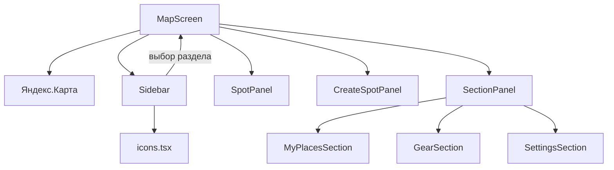
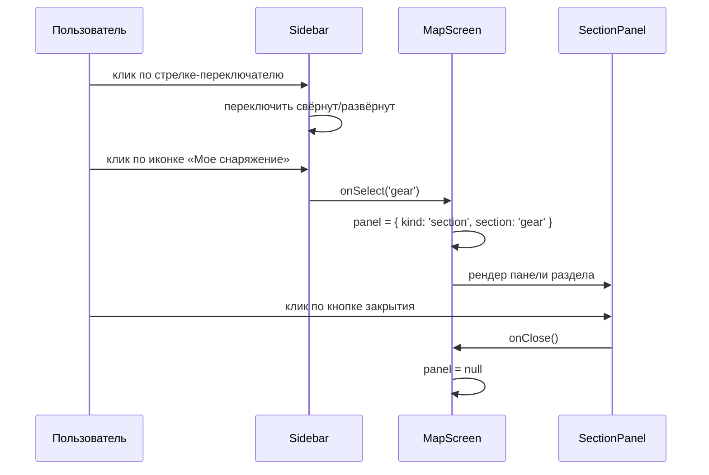

# Design

[[_TOC_]]

## Введение

Главный экран сейчас — это `MapScreen` с картой и двумя панелями (`SpotPanel`, `CreateSpotPanel`), переключаемыми через локальное состояние `PanelState`. Изменение добавляет навигационный каркас: постоянный узкий сайдбар слева поверх карты с иконками разделов, стрелкой collapse/expand и панелью раздела поверх карты. Разделы — заглушки, но паттерн «одна панель поверх карты за раз» и место сайдбара закрепляются уже сейчас, чтобы будущие разделы (список мест, снаряжение, настройки) встраивались без переделки навигации.

В рамках этого изменения мы **делаем**:

- feature-модуль меню во фронтенде: сайдбар с иконками, стрелка сворачивания, панели-заглушки разделов
- единое состояние открытой панели в `MapScreen`, включающее панели разделов
- стили сайдбара в `global.css`

Мы **не делаем** (скоуп других изменений):

- содержимое разделов «Мои места», «Мое снаряжение», «Настройки» — только заглушки
- роутинг и URL-адресацию разделов
- мобильную адаптацию, анимации, хоткеи
- изменения бэкенда, API и хранилищ

## Архитектура

Новый feature-модуль `frontend/src/features/menu/`:

- `Sidebar.tsx` — сайдбар: иконки разделов из реестра и стрелка-переключатель; локальный `useState` для свёрнут/развёрнут, колбэк выбора раздела от `MapScreen`
- `SectionPanel.tsx` — общая обёртка панели раздела (заголовок + кнопка закрытия), внутри рендерит компонент конкретного раздела
- `sections.tsx` — реестр разделов: идентификатор, заголовок, иконка, компонент-заглушка
- `icons.tsx` — инлайн-SVG иконки разделов (метка на карте, баллон, ползунки)
- `placeholders.tsx` — компоненты-заглушки разделов (`MyPlacesSection`, `GearSection`, `SettingsSection`)

Состояние открытой панели живёт в `MapScreen`: существующий `PanelState` расширяется вариантом `{ kind: 'section', section: SectionId }`. Состояние свёрнутости сайдбара — локальный `useState` в `Sidebar`, наружу не поднимается. Единственность панели достигается тем, что все панели — варианты одного union-типа: выбор раздела или клик по карте просто заменяют значение состояния.

Сайдбар — обычный React-элемент, абсолютно позиционированный у левого края поверх карты на всю высоту (правый край уже занят `YMapZoomControl`). Он не встраивается в `YMapControls`: контролы карты управляются картографическим API и рассчитаны на кнопки карты, а меню — элемент приложения со своим поведением.

## Процесс

## Риски / Ограничения

- [Сайдбар перекрывает левый край карты] -> принимаем: полоса узкая (ширина одной иконки с отступами), интерактивность карты рядом не страдает; при появлении новых контролов слева пересмотрим раскладку в рамках их изменения
- [Иконки без подписей неочевидны новому пользователю] -> смягчаем: у иконок есть `aria-label` и `title` с названием раздела, сайдбар можно развернуть стрелкой
- [Состояние панелей распухнет по мере роста приложения] -> принимаем: union-тип в `MapScreen` достаточен для MVP; переход на роутер или стейт-менеджер — отдельное решение, когда появятся реальные разделы с собственным состоянием

## Решения

**Сайдбар — React-элемент поверх карты, а не контрол Яндекс.Карт.** `YMapControls` предназначен для кнопок, управляющих картой, и стилизуется картографическим API. Меню приложения в эту модель не ложится: проще и предсказуемее держать его обычным абсолютно позиционированным компонентом, как уже сделано с `.map-panel`.

**Иконки — инлайн-SVG, а не иконочный шрифт или библиотека.** В проекте нет иконочных зависимостей, а нужно всего три пиктограммы; три маленьких SVG-компонента в `icons.tsx` решают задачу без новых зависимостей.

**Панель раздела — вариант единого `PanelState`, а не отдельное состояние.** Сейчас панель места и создания уже переключаются через один union-тип. Добавление варианта `section` бесплатно даёт инвариант «одна панель за раз» и автоматически реализует правило из дельты `product/map`: клик по пустой точке карты заменяет любую открытую панель, включая панель раздела. Альтернатива — отдельный `useState` для раздела — требовала бы ручной синхронизации закрытия между двумя состояниями.

**Свёрнутость сайдбара — локальное состояние `Sidebar`.** Состояние «свёрнут/развёрнут» не влияет ни на что, кроме вида самого сайдбара, поэтому поднимать его в `MapScreen` не нужно.

**Реестр разделов вместо трёх хардкод-панелей.** Сайдбар и панель раздела берут пункты из одного реестра (`id`, `title`, `icon`, `component`), поэтому состав разделов описан один раз и не расходится между иконками сайдбара и содержимым панели. Роутер не вводим: в проекте его нет, экранов кроме карты нет, а URL-адресация разделов не входит в скоуп.

**Стили — в существующий `global.css`.** Проект пока держит все стили в одном файле, CSS-модули и библиотеки не используются; меню следует этому соглашению (классы `.sidebar`, `.sidebar--expanded`, `.sidebar-list`, переиспользование `.map-panel` для панели раздела).

## Дальнейшие шаги

- Наполнение разделов реальным содержимым: «Мои места» — список мест (этап 2 по AGENTS.md), «Мое снаряжение» и «Настройки» — отдельные изменения после продуктового решения владельца
- Закрытие панели по Esc и клику вне панели — когда появится потребность
- Адаптация меню под мобильные экраны — вместе с остальной мобильной вёрсткой
