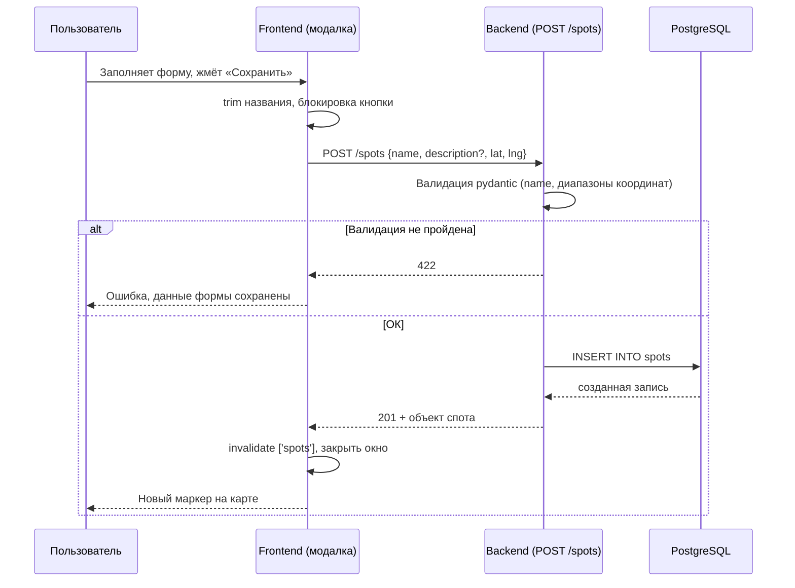

# Design

## Введение

Сейчас бэкенд умеет только читать споты (`GET /spots` → use-case `ListSpots` → `SpotRepository.get_all`), а модалка создания места во фронтенде отдаёт данные в обработчик-заглушку. Изменение добавляет путь создания спота сквозь все слои по уже принятой в проекте DDD-схеме (router → application use-case → domain repository protocol → SQLAlchemy implementation) и подключает к нему модалку через react-query mutation.

В рамках этого изменения мы **делаем**:

- `POST /spots` на бэкенде: создание спота в PostgreSQL, валидация входа, ответ 201 с созданным объектом.
- Фронтенд: отправку формы создания через `POST /spots`, инвалидацию кэша `['spots']` после успеха, состояние отправки и сообщение об ошибке в модалке.

Мы **не делаем** (скоуп других изменений):

- Загрузку фотографий (файлы из формы не отправляются; этап «Фото» — отдельное изменение, Minio появится там).
- Редактирование/удаление спота, журнал погружений.
- Миграции БД — таблица `spots` уже существует и покрывает все поля запроса.

## Контракты

### POST /spots

Запрос:

```json
{
  "name": "Байкал, Листвянка",
  "description": "Лёд прозрачный",
  "lat": 51.851,
  "lng": 104.872
}
```

- `name: string` — обязателен, непустой после trim;
- `description: string | null` — опционален;
- `lat: number` — обязателен, диапазон −90..90;
- `lng: number` — обязателен, диапазон −180..180.

Ответ 201 Created — созданный объект (поля совпадают с `SpotResponse` существующего `GET /spots`):

```json
{
  "id": "3fa85f64-5717-4562-b3fc-2c963f66afa6",
  "name": "Байкал, Листвянка",
  "description": "Лёд прозрачный",
  "lat": 51.851,
  "lng": 104.872
}
```

Ответ 422 Unprocessable Entity — стандартный формат ошибок валидации FastAPI. Авторизация не требуется (соответствует существующему `GET /spots`).

## Хранение и данные

### PostgreSQL (данные)

Новых структур нет: запись добавляется в существующую таблицу `spots` (`id`, `name`, `description`, `lat`, `lng`, `created_at`, `updated_at`). `id` генерируется на уровне модели (`uuid4`), временные метки — на уровне БД. Миграции не требуются.

### Minio (файлы)

Не затрагивается. Фото спота — этап 4 «Фото», отдельное изменение.

## Архитектура

```mermaid
flowchart LR
    subgraph Frontend
        Modal[CreateSpotModal] -->|draft| Mutation[useMutation: createSpot]
        Mutation -->|invalidate ['spots']| Query[useQuery: fetchSpots]
        Query --> Map[YMap markers]
    end
    subgraph Backend
        Router[routers/spots.py] --> UseCase[application: CreateSpot]
        UseCase --> RepoProto[domain: SpotRepository]
        RepoProto --> RepoImpl[infrastructure: SqlAlchemySpotRepository]
        RepoImpl --> DB[(PostgreSQL: spots)]
    end
    Mutation -->|POST /spots| Router
```

## Процесс



## Конфигурация

Новых параметров и переменных окружения не вводится.

## Риски / Ограничения

- [Двойной клик по «Сохранить» создаст дубликат] -> смягчаем блокировкой кнопки на время запроса (isPending в mutation). Полной идемпотентности не делаем: для MVP с одним пользователем достаточно.
- [Публичная запись без авторизации — кто угодно по ссылке может создавать споты] -> принимаем осознанно: это зафиксированный открытый вопрос AGENTS.md, решение владельца до деплоя куска 2. Эндпоинт сознательно без авторизации, симметрично `GET /spots`.
- [Фото, выбранные в форме, молча не сохранятся] -> принимаем: загрузка фото явно отложена (этап 4). В UI формы фото остаются только как выбор до сохранения — поведение не хуже текущего, где форма вообще ничего не сохраняет.

## Решения

**Слой валидации — pydantic-модель запроса в роутере, а не домен.** Границы диапазонов координат и обязательность названия выражаются через `Field(ge=..., le=...)` и `min_length` с trim-валидацией; FastAPI сам отдаёт 422. Это соответствует тому, как уже построены роутеры проекта (модели запроса/ответа живут рядом с роутером), и не тащит HTTP-детали в домен. Доменный `Spot` остаётся неизменным — в него добавляется только метод `create` в протоколе репозитория.

**Use-case `CreateSpot` в application-слое, симметрично `ListSpots`.** Принимает репозиторий и входные данные, возвращает `SpotDTO`. Никакой бизнес-логики сверх делегирования сейчас нет, но слой сохраняем для единообразия архитектуры: сюда позже ляжет загрузка фото.

**Коммит транзакции — в реализации репозитория.** `SqlAlchemySpotRepository.create` делает `add` + `commit` + `refresh`, чтобы вернуть серверные значения (`created_at`). Сессия по-прежнему управляется зависимостью `get_db_session`; явный commit в репозитории — минимальное расширение существующего паттерна (без unit-of-work, которого в проекте пока нет).

**На фронтенде — `useMutation` с инвалидацией `['spots']`, а не ручное обновление стейта.** Список спотов уже читается через react-query; инвалидация гарантирует, что маркер на карте появляется из тех же данных, что и при загрузке страницы, без рассинхрона локального стейта с сервером. Оптимистичное обновление не нужно: запрос локальный/быстрый, а сценарий ошибки проще — форма просто остаётся открытой.

**Состояние отправки и ошибки — локально в `CreateSpotModal`, через пропсы от mutation в `MapScreen`.** Модалка уже управляет своими полями; передаём ей `isPending`/`error` от mutation, чтобы при ошибке окно не закрывалось и введённые данные не терялись. Закрытие окна — только в `onSuccess`.

## Дальнейшие шаги

- Загрузка фото при создании спота (multipart или отдельный эндпоинт загрузки + привязка к споту) — этап 4, вместе с Minio.
- Открытый вопрос из AGENTS.md: публичная запись без авторизации — решение владельца до деплоя куска 2.
- Индикация «сохраняем…» (спиннер на кнопке) — косметика, можно доуточнить при полировке MVP.
