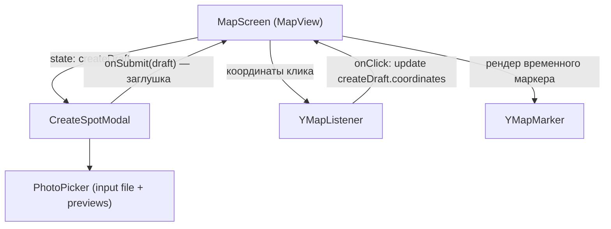
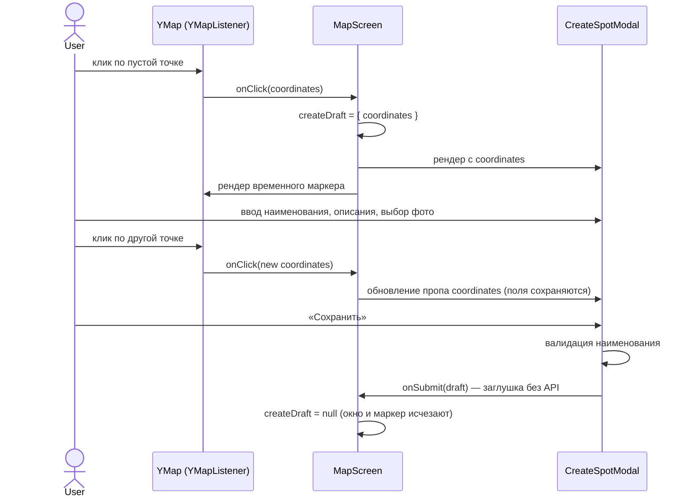

# Design

[[_TOC_]]

## Введение

Сейчас клик по пустой точке карты открывает боковую панель-заглушку `CreateSpotPanel` (`frontend/src/features/map/CreateSpotPanel.tsx`), которая показывает только координаты. Изменение заменяет её полноценным модальным окном создания места с формой (наименование, read-only координаты, описание, загрузка фото) и добавляет временный маркер с перестановкой кликом по карте. Бэкенд и API уже частично существуют (`GET /spots`), но это изменение сознательно ограничено фронтендом.

В рамках этого изменения мы **делаем**:

- модальное окно создания места поверх карты с полями формы и валидацией наименования;
- временный маркер точки создания и его перестановку повторным кликом по карте без потери введённых данных;
- блок выбора фотографий с предпросмотром и лимитом 10 файлов;
- обработчик сохранения-заглушку (валидация, сбор данных, закрытие — без запроса к API).

Мы **не делаем** (скоуп других изменений):

- `POST /spots`, загрузку фото в Minio, появление созданного места на карте — следующее изменение (API-интеграция);
- редактирование/удаление места, карточку места, журнал погружений;
- мобильную адаптацию модального окна.

## Хранение и данные

Новых постоянных данных изменение не вводит: состояние формы (наименование, описание, список `File`, координаты) живёт в локальном состоянии React-компонента и отбрасывается при закрытии.

Появится позже, в следующем изменении (API-интеграция): запись Spot в PostgreSQL и файлы фотографий в Minio.

## Архитектура

- `MapScreen` держит состояние `createDraft: { coordinates } | null` вместо текущего `panel.kind === 'create'`. Клик `YMapListener` по пустой точке: если черновика нет — создаёт его; если есть — обновляет координаты (перестановка маркера).
- `CreateSpotModal` — контролируемая форма: локальное состояние полей, валидация наименования (непустое после trim), координаты приходят пропом и отображаются read-only. Обновление пропа координат не сбрасывает остальные поля, так как они хранятся внутри компонента, а координаты — снаружи.
- `PhotoPicker` — выбор файлов через `<input type="file" multiple accept="image/*">`, предпросмотр через `URL.createObjectURL` с отзывом URL при удалении файла и размонтировании.
- Сайдбар и панели разделов остаются как есть: открытие модалки создания заменяет открытую панель, и наоборот — одновременно только один элемент поверх карты.

## Процесс

## Конфигурация

Новых параметров и переменных окружения не вводится.

## Риски / Ограничения

- [Конфликт «подложка закрывает» vs «клик по карте переставляет маркер»] -> принимаем: подложка только визуально затемняет карту (`pointer-events: none`), клики проходят на карту и переставляют маркер; закрытие — только «Отмена», крестик, Esc. Альтернатива (блокирующая подложка + перетаскивание маркера) отвергнута: владелец подтвердил перестановку именно кликом, а drag маркера в ymaps3 требует отдельной реализации.
- [«Сохранить» не сохраняет: данные пропадают] -> принимаем как осознанное промежуточное состояние первого шага; риск недопонимания смягчается тем, что приложение — песочница одного владельца, а API-интеграция запланирована следующим изменением.
- [Утечка object URL при предпросмотре фото] -> смягчаем: `URL.revokeObjectURL` при удалении файла из списка и при размонтировании компонента.
- [Большие фото в предпросмотре едят память] -> принимаем: лимит 10 файлов за раз достаточен для MVP; сжатие/ресайз — вне скоупа.

## Решения

**Модалка — собственный оверлей, а не нативный `<dialog showModal()>`.** Нативный модальный диалог делает весь остальной документ инертным: клики по карте не дойдут до `YMapListener`, и перестановка маркера сломается. Немодальный `show()` теряет Esc-закрытие и top-layer «из коробки». Поэтому — обычный оверлей на `position: fixed` с `role="dialog"` и `aria-modal="true"`, собственным обработчиком Esc и подложкой с `pointer-events: none`. Новых зависимостей не добавляем: для одного модального окна библиотека (Radix и т.п.) избыточна; стили — в существующий `global.css` по аналогии с `map-panel`.

**Координаты живут снаружи формы, остальные поля — внутри.** Координаты определяются картой (источник — `MapScreen`), поэтому передаются в модалку пропом и меняются кликом; наименование, описание и файлы — локальное состояние модалки, поэтому перестановка маркера их не сбрасывает. Это же разделение ляжет в будущий `POST /spots`: координаты + поля формы собираются в один payload в обработчике `onSubmit`.

**Сохранение — функция-заглушка `onSubmit(draft)`.** Модалка отдаёт собранный черновик наружу и ничего не знает про API. В следующем изменении заглушка заменяется на react-query мутацию (`POST /spots` + загрузка фото) без переработки самой формы. `Spot` в `frontend/src/api/spots.ts` уже содержит `name/description/lat/lng`, что подтверждает совместимость формы с будущим контрактом.

## Дальнейшие шаги

- API-интеграция: `POST /spots`, загрузка фото, инвалидация кэша `['spots']`, появление маркера после сохранения, состояния загрузки/ошибки в модалке.
- Обновить AGENTS.md: формы — модальные окна поверх карты (не панели).
- Редактирование места: та же модалка в режиме редактирования (предзаполненные поля, кнопка «Удалить»).
- При появлении второго модального окна — переоценить необходимость библиотеки (focus-trap, порталы).
