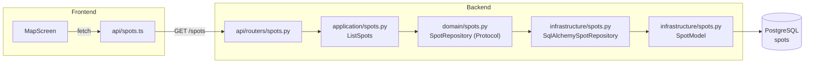
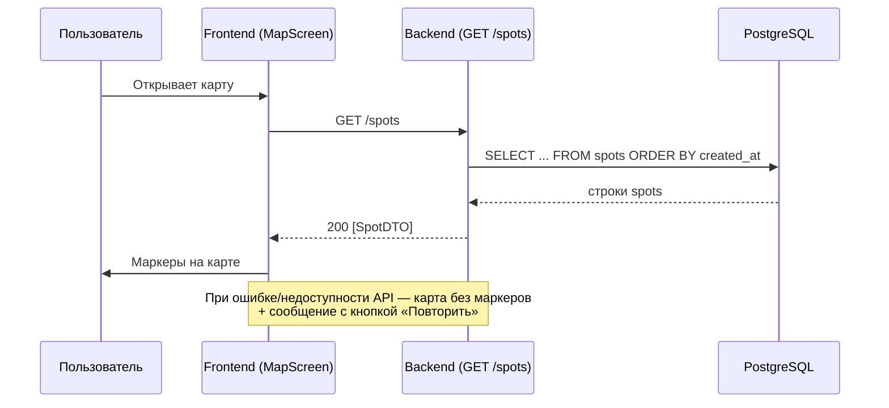

# Design

[[_TOC_]]

## Введение

Сейчас споты на карте — хардкод `demoSpots` в `frontend/src/features/map/spots.ts`, бэкенд сущности Spot не знает вовсе. Изменение переносит три демо-точки в PostgreSQL, добавляет read-only эндпоинт `GET /spots` и переводит карту на загрузку данных через API. Бэкенд уже имеет устоявшуюся DDD-структуру (`domain/` — сущности и протоколы репозиториев, `application/` — use-case'ы и DTO, `infrastructure/` — SQLAlchemy-модели и репозитории, `api/` — роутеры и зависимости), которую это изменение повторяет для новой сущности.

В рамках этого изменения мы **делаем**:

- таблицу `spots` в PostgreSQL + миграцию Alembic с сидами трёх демо-точек;
- эндпоинт `GET /spots` (read-only, без авторизации);
- клиентский запрос списка спотов во фронтенде и его рендер на карте с состояниями загрузки/ошибки;
- удаление хардкода `demoSpots`.

Мы **не делаем** (скоуп других изменений):

- создание/редактирование/удаление спотов — этап «Карта + Spot»;
- погружения (Dive) и фото — следующие этапы MVP;
- пагинацию и фильтры списка спотов.

## Контракты

### `GET /spots`

Список всех спотов, без параметров и авторизации. Порядок — по времени создания (стабильный для отображения).

**Ответ `200 OK`** — JSON-массив:

```json
[
  {
    "id": "3f6b2f0e-...-uuid",
    "name": "Байкал, Листвянка",
    "description": "Ледовые погружения, прозрачность до 40 метров.",
    "lat": 51.8461,
    "lng": 104.8722
  }
]
```

Поля `lat`/`lng` — числа с плавающей точкой (градусы). `description` может быть `null`. Пустой список — `[]` с тем же статусом 200.

Ошибки: при недоступности БД — стандартный `500` FastAPI, специальной обработки не требуется.

## Хранение и данные

### PostgreSQL (данные)

Новая таблица `spots` — одна миграция Alembic (create + seed в одной ревизии, сиды только в `upgrade`; в `downgrade` таблица удаляется целиком, отдельно чистить строки не нужно):

| Поле | Тип | Ограничения |
| --- | --- | --- |
| `id` | UUID | PK, генерируется приложением |
| `name` | Text | NOT NULL |
| `description` | Text | NULL |
| `lat` | Double Precision | NOT NULL |
| `lng` | Double Precision | NOT NULL |
| `created_at` | DateTime(tz) | NOT NULL, server default `now()` |
| `updated_at` | DateTime(tz) | NOT NULL, server default `now()` |

Сиды: три демо-точки из `frontend/src/features/map/spots.ts` с теми же координатами и описаниями; UUID фиксированы в миграции, чтобы среды воспроизводились одинаково.

Фото спотов (Minio) и таблица погружений появятся позже, в этапах 3–4 MVP.

## Архитектура

Изменение повторяет существующую слоистую структуру бэкенда, как у `User`:



- `domain/spots.py`: pydantic-сущность `Spot` (frozen) + протокол `SpotRepository` с методом получения всех спотов — аналогично `domain/users.py`.
- `infrastructure/spots.py`: `SpotModel(Base)` с `to_domain()` + `SqlAlchemySpotRepository` на сессии SQLAlchemy — аналогично `infrastructure/users.py`.
- `application/spots.py`: DTO `SpotDTO` + use-case `ListSpots` — аналогично `application/users.py`.
- `api/routers/spots.py`: роутер `/spots` со схемой ответа; регистрация в `api/app.py` рядом с `health_router` и `users_router`.
- `api/dependencies.py`: провайдер `get_spot_repository` по образцу `get_user_repository`.

## Процесс



Последовательность реализации: миграция → слои backend (domain → infrastructure → application → router) → запуск backend, проверка ручки → клиентский модуль `api/spots.ts` → перерисовка `MapScreen` → удаление хардкода.

## Конфигурация

Изменение не вводит новых параметров: фронтенд использует существующий `VITE_API_BASE` (уже есть в `api/client.ts`), бэкенд — существующие настройки подключения к БД из `settings.py`.

## Риски / Ограничения

- [Сиды в миграции смешивают схему и данные] -> принимаем: демо-данные нужны одинаковыми во всех средах, а отдельный seed-скрипт для трёх строк — лишняя инфраструктура. Когда появится создание спотов через UI, демо-записи можно будет удалить вручную.
- [Отказ API оставляет карту без маркеров] -> смягчаем явным сообщением об ошибке с повтором запроса; кеширование/офлайн не делаем — избыточно для MVP.
- [Координаты в API (lat, lng) и в Яндекс.Картах ([lng, lat]) идут в разном порядке] -> смягчаем единственной точкой конвертации на клиенте в `MapScreen` и сид-данными, уже проверенными на карте.

## Решения

Порядок координат в API выбран как отдельные поля `lat`/`lng` вместо массива `[lng, lat]`: REST-контракт не должен знать о порядке координат конкретной картографической библиотеки — массив `[lng, lat]` это деталь Яндекс.Карт, и конвертация в одном месте на клиенте дешевле, чем наследование чужого формата в контракте.

Репозиторий оформлен протоколом в domain-слое, а не прямым использованием SQLAlchemy-модели в роутере — это повторяет уже принятый в проекте подход (`UserRepository`/`SqlAlchemyUserRepository`) и держит слои развязанными; альтернатива «проще — один файл» противоречила бы существующей архитектуре без выигрыша.

Идентификатор спота — UUID (как у `User`), а не serial int: единообразие с существующей моделью и отсутствие проблем при вставке сидов с заранее известными id.

## Дальнейшие шаги

- Создание спота кликом по карте (`POST /spots`) и `CreateSpotPanel` — следующий change этапа «Карта + Spot»; там же каскадное удаление и сайдбар со списком мест.
- Сущность Dive и фото — этапы 3–4 MVP.
- Открытый вопрос публичной записи без авторизации (из AGENTS.md) остаётся владельцу до деплоя этапа 2; read-only эндпоинт этого change его не усугубляет.
