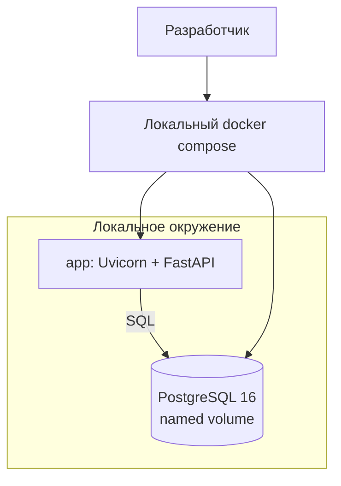
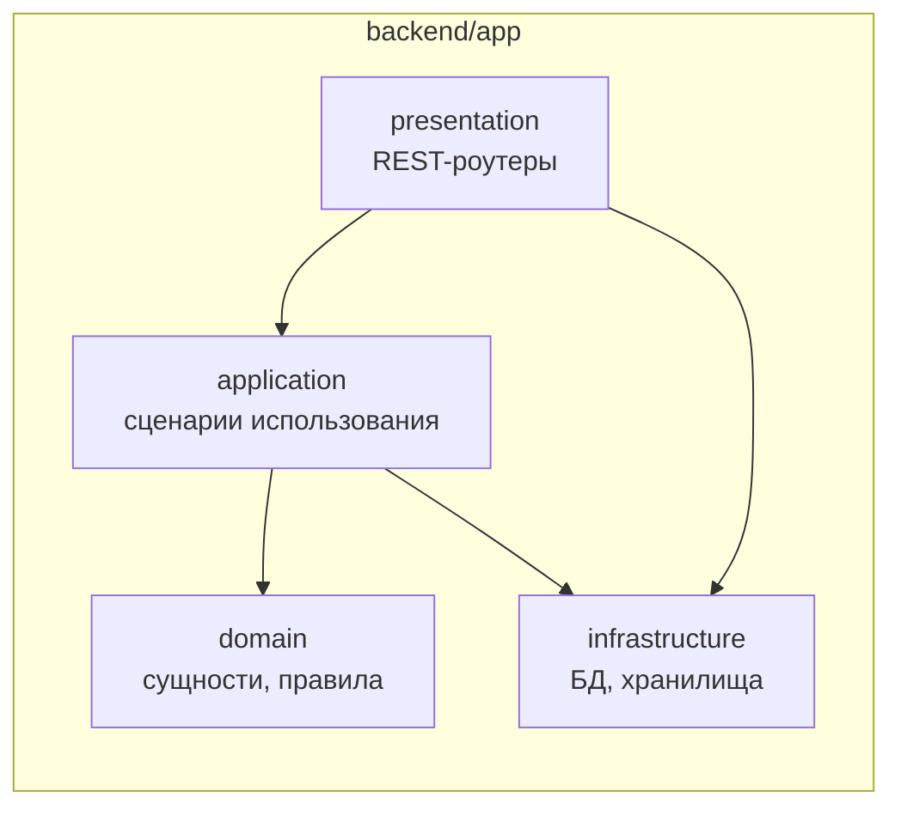

# Design

## Context

Проект divemap — персональный дайвлог с интерактивной картой (приёмка и скоуп — в `AGENTS.md`). Репозиторий greenfield: только документация (README-заглушка, CONTRIBUTING с conventional commits, `.gitignore` с исключённым `.env`), кода и инфраструктуры нет. Это изменение реализует этап 1 — фундамент, в минимальном объёме: только локальное окружение разработки.

Ограничения и вводные:

- Стек зафиксирован в `AGENTS.md`: FastAPI + SQLAlchemy 2.0 + Alembic + pydantic-settings; PostgreSQL в Docker Compose.
- Контекст проекта (`openspec/config.yaml`): архитектура Domain-Driven Design, API по принципам REST, код в `backend/`. Клиентская часть вынесена в отдельное изменение, вне границ этой спеки.
- Деплой на VPS, домен, TLS и публичная ссылка отложены — будут отдельным изменением позже.
- Minio (объектное хранилище) отложен до этапа «Фото» (этап 4).
- База backend-сервиса — шаблон репозитория `git@github.com:ab-budaev/python-template.git` (FastAPI-заготовка через Copier), докручивается под требования спеки.
- Каталог `adr/` в репозитории отсутствует — действующих ADR нет, данный документ фиксирует первые решения.

## Goals / Non-Goals

Goals:

- Локальный запуск окружения (приложение + PostgreSQL) одной командой, данные переживают перезапуск контейнеров
- Каркас бэкенда со слоистой DDD-структурой и REST-контрактом, готовый к этапам 2–4 без переделки инфраструктуры
- Служебный контракт живости сервиса

Non-Goals:

- Деплой на VPS, reverse proxy (Caddy), домен, TLS, публичная ссылка — отдельное изменение позже
- Объектное хранилище Minio — добавляется в этапе «Фото»
- Бизнес-функциональность: сущности Spot/Dive, карта, загрузка и показ фото
- Авторизация и разграничение доступа
- CI/CD, мониторинг и алертинг

## Архитектура

Структура бэкенда — DDD-слои, наполняются по мере этапов:

## Decisions

### 1. Шаблон python-template как основа backend-сервиса

Backend-каркас генерируется из шаблона `git@github.com:ab-budaev/python-template.git` через Copier, затем докручивается под требования спеки: шаблон уже даёт FastAPI-приложение с health-роутером, конфигурацию из `.env` через pydantic-settings, Dockerfile, композ, Makefile, логирование, тесты и линтеры. Это ускоряет старт и задействует уже отработанные решения операционного слоя.

Чего в шаблоне нет и что добавляется в этой спеке: PostgreSQL (SQLAlchemy 2.0 + psycopg), Alembic с миграциями, DDD-слои, сервис `db` в compose. Health-контракт остаётся как в шаблоне (простая проверка живости сервиса, без проверки БД — техкачество наведём позже). Лишние для текущего скоупа фичи шаблона (телеметрия, devcontainer, CI) сохраняются как есть — их удаление/адаптация не входит в эту спеку.

**Альтернативы:**

- Писать каркас полностью с нуля: отклонена — дольше, теряются отработанные операционные решения (логирование, линтеры, Dockerfile).
- Взять другой шаблон/стартер: отклонён — собственный шаблон владельца уже покрывает нужный стек и является точкой стандартизации.

### 2. Только локальное окружение, без деплоя

Полноценный bootstrap (VPS, Caddy, домен, публичная ссылка) откладывается: сначала нужен работающий контур разработки для этапов 2–4. Критерий MVP «публичная ссылка» закрывается последующим изменением про деплой.

**Альтернативы:**

- Полный bootstrap сразу (VPS + Caddy + домен): отклонён решением владельца — избыточен для старта разработки, домен и сервер ещё не готовы.

### 3. Minio откладывается до этапа «Фото»

Файловое хранилище не нужно до появления загрузки фото (этап 4). Без Minio фундамент проще: меньше сервисов, томов и секретов; compose-контур расширяется в этапе 4 одним сервисом.

**Альтернативы:**

- Включить Minio в фундамент сразу: отклонено решением владельца — нет потребителя до этапа 4, лишняя сложность на старте.
- Файлы в базе или на диске приложения позже: отклонены — нет S3-совместимого API, сложно расширять и бэкапить.

### 4. PostgreSQL 16 в Docker Compose с именованным томом

Критерии MVP требуют реального хранения, переживающего рестарт; локальная среда должна совпадать с будущим продом.

**Альтернативы:**

- SQLite: отклонён — расходится с прод-окружением (PostgreSQL зафиксирован в `AGENTS.md`).

### 5. Слоистая DDD-структура бэкенда

Слои `presentation / application / domain / infrastructure` создаются каркасом сейчас и наполняются по этапам (domain появится с сущностями Spot/Dive). Соответствует контексту проекта и не даёт бизнес-логике протечь в роутеры.

**Альтернативы:**

- Плоская структура «роутеры + модели»: отклонена — противоречит заявленной в контексте проекта архитектуре, дороже переносить позже.

### 6. Синхронный SQLAlchemy 2.0

FastAPI исполняет синхронные вызовы в threadpool — для CRUD одного пользователя достаточно, код проще, миграции и документация ближе к канону.

**Альтернативы:**

- Async SQLAlchemy + asyncpg: отклонена — двойная сложность (async engine, async-миграции) без измеримой выгоды для MVP.

### 7. Миграции Alembic применяются при старте контейнера приложения

`docker compose up --build` поднимает базу, накатывает миграции и стартует сервер одной последовательностью; гонка закрыта `depends_on: service_healthy` и повторными попытками подключения.

**Альтернативы:**

- Ручной запуск миграций отдельной командой: отклонена — легко забыть, лишний шаг в запуске.

### 8. Конфигурация только через переменные окружения

`pydantic-settings` читает `.env`; `.env.example` документирует переменные и лежит в репозитории, секреты — нет.

**Альтернативы:**

- Хардкод значений / разные конфиги для сред: отклонены — рассинхронизация и риск закоммитить секреты.

### 9. Управление зависимостями Python — uv

Быстрый, lock-файл из коробки; проект — песочница технологий.

**Альтернативы:**

- pip + requirements.txt: отклонён — нет lock-файла.
- Poetry: отклонён — тяжелее и медленнее uv при сопоставимых возможностях.

## Risks / Trade-offs

- [Шаблон привносит не заявленные в спеке фичи (телеметрия, devcontainer, CI)] -> осознанно сохраняются как есть; они расширяют скоуп за пределы спеки, но адаптация/удаление не входят в это изменение
- [Миграции при старте контейнера] -> только один инстанс приложения; при появлении реплик выносить в отдельный job
- [Нет прода и публичной ссылки после этого изменения] -> осознанно: критерий MVP закрывается отдельным изменением про деплой
- [Health-контракт — простой, без проверки БД] -> осознанно для данного этапа; проверка подключения к PostgreSQL наводится позже, отдельным техкачеством

## Migration Plan

Не применимо: зелёное поле, деплоя и данных нет. Добавление Minio и деплоя позже — расширение compose-контура, обратной миграции не требует.

## Open Questions

- **Деплой и публичная ссылка**: когда и как (VPS, Caddy, домен, TLS) — отдельное изменение после этапа 2
- **Авторизация публичной записи**: открытый вопрос `AGENTS.md` — любой по ссылке сможет редактировать данные; решение владельца требуется до деплоя
- **ADR-процесс**: каталога `adr/` нет; если процесс заведётся, решения из этого документа (DDD-слои, uv, синхронный SQLAlchemy) следует оформить стартовыми ADR
